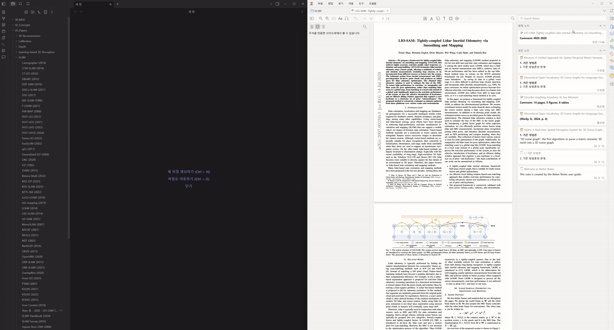
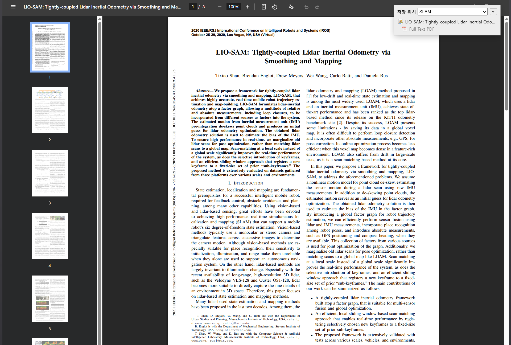
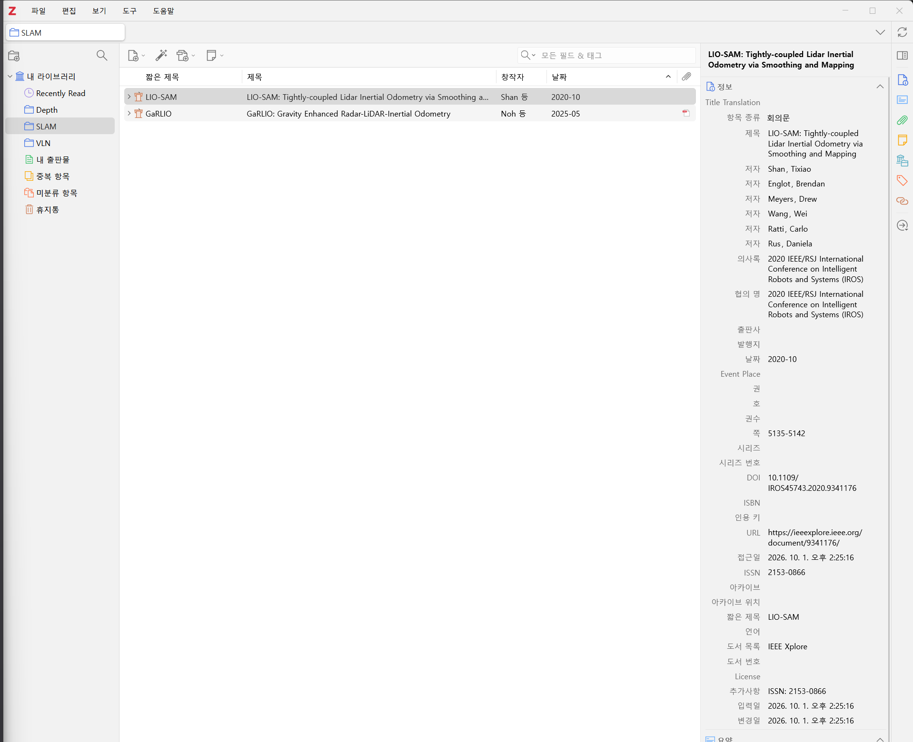
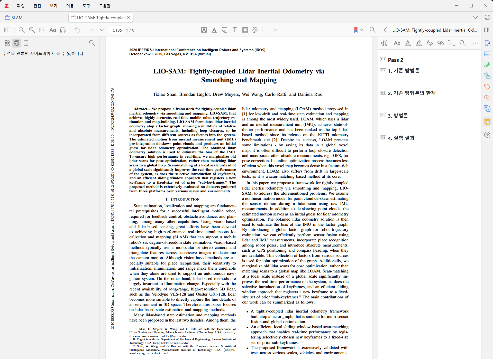
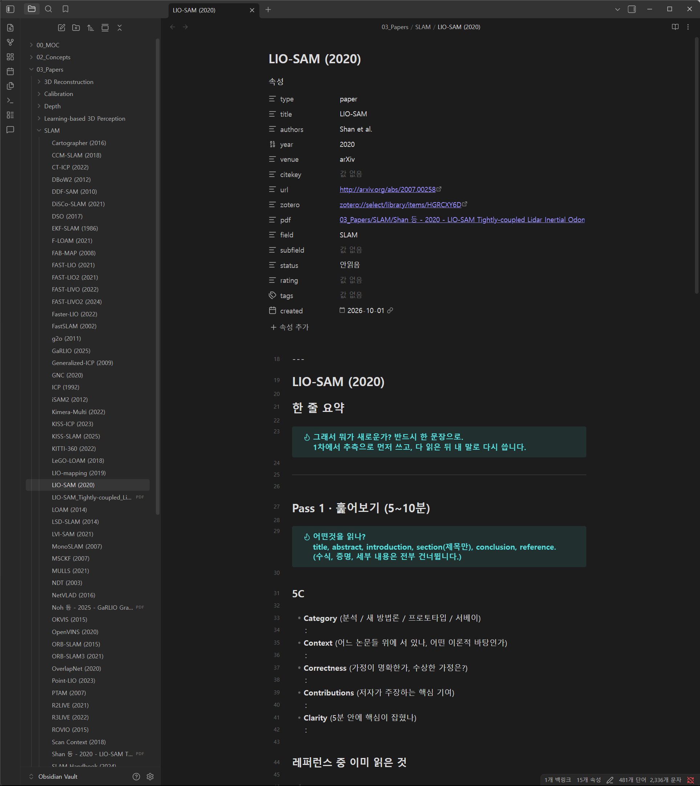

# zotero2obsidian-autosync

[English](README.md) | **한국어**

S. Keshav의 [How to Read a Paper](https://web.stanford.edu/class/ee384m/Handouts/HowtoReadPaper.pdf)(three-pass 읽기법)를 Zotero와 Obsidian에서 그대로 따라 할 수 있게 만든 **논문 노트 템플릿**과, Zotero에서 정리한 노트를 Obsidian으로 **자동 동기화**하는 Zotero 플러그인입니다. Windows, macOS, Linux에서 동작합니다.



## 이 논문 읽기법을 따라가는 노트

논문을 한 번에 끝까지 읽는 대신, 목적이 다른 세 번의 패스로 나눠 읽는 방법입니다. 논문마다 노트가 하나씩 생기고, 노트는 세 패스 순서로 구성되어 있어서 위에서 아래로 채우면 됩니다.

| 패스 | 걸리는 시간 | 하는 일 | 어디서 쓰나 |
|---|---|---|---|
| **Pass 1** 훑어보기 | 5~10분 | 제목·초록·서론·결론만 보고 5C(Category, Context, Correctness, Contributions, Clarity)를 적고, 계속 읽을지 정합니다 | Obsidian |
| **Pass 2** 내용 파악 | 약 1시간 | 그림과 표를 보며 기존 방법론, 그 한계, 이 논문의 방법론, 실험 결과를 정리합니다. 수식 증명은 건너뜁니다 | **Zotero** → Obsidian에 자동 동기화 |
| **Pass 3** 가상으로 다시 써보기 | 1~5시간 | 저자와 같은 가정에서 출발해 직접 다시 만들어 보고, 원문과 비교해 숨은 가정과 한계를 찾습니다 | Obsidian |

Pass 2만 Zotero에서 쓰는 이유는 논문 PDF와 그림 옆에서 정리하는 게 편하기 때문입니다. 나머지는 Obsidian에서 바로 씁니다. 이 둘이 한 노트로 합쳐지도록 플러그인이 중간을 이어 줍니다.

### 한눈에 보는 흐름

<table>
<tr>
<td width="50%" valign="top"><br><b>1. 논문 저장</b><br>브라우저에서 Zotero Connector로 논문을 저장합니다. 저장할 <b>컬렉션</b>이 볼트의 폴더가 됩니다.</td>
<td width="50%" valign="top"><br><b>2. Zotero에 추가됨</b><br>서지 정보가 채워집니다. <b>짧은 제목</b>(Short Title)이 Obsidian 노트 이름이 됩니다.</td>
</tr>
<tr>
<td width="50%" valign="top"><br><b>3. Pass 2 노트</b><br>PDF 옆에 1~4번 헤더가 들어 있는 Pass 2 노트가 자동으로 생깁니다. 여기에 정리합니다.</td>
<td width="50%" valign="top"><br><b>4. Obsidian 노트</b><br>볼트에 논문 노트가 생기고 속성이 채워집니다. Pass 2 내용은 몇 초 안에 따라옵니다.</td>
</tr>
</table>

### 노트 템플릿 구성

[`addon/templates/paper-note.md`](addon/templates/paper-note.md)가 Obsidian 노트 템플릿이고, [`addon/templates/pass2-note.html`](addon/templates/pass2-note.html)이 Zotero의 Pass 2 노트 템플릿(Better Notes)입니다. 둘 다 플러그인에 들어 있어서 따로 복사할 필요가 없습니다.

| 영역 | 내용 |
|---|---|
| 속성 | `title`, `authors`, `year`, `venue`, `url`, `zotero`, `pdf` 등은 자동으로 채워집니다. `pass`(끝낸 패스, 예: `1`, `2`, `3`)와 `status`(안읽음 → 정리됨)는 직접 씁니다 |
| 한 줄 요약 | "그래서 뭐가 새로운가?"를 한 문장으로. Pass 1에서 추측으로 먼저 쓰고, 다 읽은 뒤 내 말로 다시 씁니다 |
| Pass 1 | 5C, 레퍼런스 중 이미 읽은 것, 계속 읽을지 체크리스트 |
| Pass 2 | Zotero에서 오는 1~4번 섹션(기존 방법론 / 한계 / 방법론 / 실험 결과), 핵심 주장과 근거 표, 막힌 곳 |
| Pass 3 | 가정 목록, 나라면 이렇게 했다, 내 생각과 논문의 한계, 내 글쓰기에 가져갈 것 |
| 관련 개념, 읽고 나면 | 이 논문의 기여가 걸린 개념, 마무리 체크리스트 |

영어 템플릿은 [`templates/en/`](templates/en/)에 있습니다. [다른 언어로 쓰기](#다른-언어로-쓰기)를 보세요.

## 하는 일

Zotero에 논문을 추가하면 Obsidian 볼트에 논문 노트가 생기고, Zotero에서 정리한 Pass 2 노트가 그 노트 안으로 계속 동기화됩니다.

- 새 논문 → 템플릿으로 노트 생성, 속성(저자·연도·학회·URL·Zotero 링크·PDF 링크) 자동 입력
- 새 논문 → Better Notes 템플릿으로 Pass 2 노트 자동 생성
- Zotero의 Pass 2 노트(1~4번 섹션) → Obsidian 노트의 같은 이름 헤더 밑으로 복사, 그림 포함
- Zotero 컬렉션 → 볼트의 폴더 (`Papers/<컬렉션>/`). 컬렉션을 바꾸면 노트가 따라 옮겨지고, [ZotMoov](https://github.com/wileyyugioh/zotmoov)를 쓰면 PDF도 따라 옮겨집니다.

Zotero 안에서 도는 플러그인이라 Zotero의 이벤트를 직접 받습니다. 무언가 바뀌면 **3초** 기다렸다가 한 번 동기화하므로, 노트를 입력하는 동안은 입력이 멈출 때까지 기다립니다. 따로 띄워 둘 프로그램이나 Obsidian 플러그인은 필요 없습니다.

## 준비물

| | |
|---|---|
| [Zotero](https://www.zotero.org/) 7 이상 | Zotero 9에서 쓰고 있습니다 |
| [Better Notes](https://github.com/windingwind/zotero-better-notes) | Pass 2 노트를 템플릿으로 자동 생성할 때 씁니다. 없어도 Pass 2 노트를 직접 만들면 동기화는 됩니다 |
| [ZotMoov](https://github.com/wileyyugioh/zotmoov) (선택) | PDF를 볼트 안으로 옮겨 두면 노트에 `pdf:` 링크가 걸리고, 컬렉션을 바꿀 때 PDF도 옮겨집니다 |
| Obsidian | 플러그인은 필요 없습니다 |

## 설치

1. [Releases](https://github.com/meteor0108/zotero2obsidian-autosync/releases)에서 `zotero2obsidian.xpi`를 받습니다. 직접 만들려면 아래 [개발](#개발)을 보세요.
2. Zotero → 도구 → 플러그인 → 톱니바퀴 → **Install Plugin From File…** 에서 받은 파일을 고릅니다.
3. Zotero → 설정 → **Zotero2Obsidian Autosync**에서 볼트 폴더를 고릅니다. 나머지는 필요하면 바꿉니다.

   | 설정 | 기본값 | 뜻 |
   |---|---|---|
   | 볼트 폴더 | (없음) | Obsidian 볼트 폴더 |
   | 논문 노트 폴더 | `Papers` | 논문 노트를 만들 볼트 안 폴더 |
   | 노트 템플릿 | `Templates/paper-note.md` | 새 노트에 쓸 템플릿. 파일이 없으면 기본 템플릿을 여기에 만듭니다 |
   | 그림 폴더 | Obsidian 첨부 폴더 + `/zotero` | Pass 2 노트 그림을 복사할 폴더 |
   | 가져올 섹션 | `1. 기존 방법론` 외 3개 | Zotero에서 가져올 섹션 헤더 이름. 한 줄에 하나 |
   | Better Notes 템플릿 이름 | `[Item]Paper Pass 2` | 이 이름의 템플릿이 Better Notes에 없으면 Zotero를 켤 때 등록합니다 |

4. 설정 창 아래의 **미리보기**를 누르면 무엇이 생길지 보여 줍니다. 파일은 쓰지 않습니다. `+ 생성`은 새로 만들 노트, `~ 연결`은 기존 노트와 짝지은 것, `?`는 애매해서 건너뛴 것입니다. 이미 볼트에 있는 논문이 `+ 생성`으로 나오면 [기존 노트와 짝짓기](#기존-노트와-짝짓기)를 보세요.
5. 괜찮으면 **지금 동기화**를 누릅니다. 그 뒤로는 자동으로 동기화됩니다.

플러그인 업데이트는 Zotero가 알아서 확인합니다.

## 쓰는 법

1. Zotero에 논문을 추가합니다. 추가하기 전에 **컬렉션**(볼트의 폴더가 됨)과 **Short Title**(노트 이름이 됨)을 정해 두세요. 노트 이름은 처음 만들 때 한 번 정해지고, 나중에 Zotero에서 바꿔도 따라 바뀌지 않습니다. 폴더는 따라갑니다. [컬렉션을 바꾸면](#컬렉션을-바꾸면)을 보세요.
2. 논문에 Pass 2 노트가 자동으로 생깁니다. 이 플러그인을 설치하기 전에 추가한 논문은 PDF를 열 때 생깁니다. Better Notes가 없으면 `1. 기존 방법론` 같은 h2 헤더가 있는 노트를 직접 만듭니다.
3. Zotero에서 Pass 2 노트를 정리하면 몇 초 뒤 Obsidian 노트의 1~4번 헤더 밑에 들어옵니다.

- Obsidian 노트의 `%% zotero:start %%` ~ `%% zotero:end %%` 사이는 매번 **덮어씁니다.** 수정은 Zotero에서 하세요. 이 표시는 읽기 화면에서는 보이지 않습니다.
- 그 밖의 부분(Pass 1, Pass 3, 한 줄 요약 등)은 Obsidian에서 자유롭게 쓰면 됩니다.
- 속성은 **비어 있을 때만** 채웁니다. 직접 쓴 값은 덮어쓰지 않습니다. 예외로, `pdf:` 링크가 가리키는 파일이 없어졌으면(ZotMoov가 PDF를 다른 폴더로 옮긴 경우) PDF의 지금 경로로 고칩니다.
- 바로 동기화하려면 Zotero → 도구 → **Obsidian으로 동기화**를 누릅니다.

### 템플릿은 언제 적용되나

- 템플릿은 **새 노트를 만들 때 한 번만** 씁니다. 동기화할 때마다 템플릿 파일을 새로 읽으므로, 템플릿을 고치면 **다음에 새로 만들어지는 노트부터** 바로 적용됩니다.
- **이미 있는 노트의 형식은 바뀌지 않습니다.** 기존 노트에서는 1~4번 섹션의 `%% zotero:start %%` ~ `%% zotero:end %%` 사이와 비어 있는 속성만 채웁니다. Obsidian에서 직접 쓴 내용을 지우지 않기 위해서입니다.
- 기존 노트에 새 형식을 적용하려면 내용을 새 템플릿으로 직접 옮기세요. Obsidian에서 아무것도 쓰지 않은 노트라면 지우는 방법도 있습니다. 몇 초 안에 새 템플릿으로 다시 만들어집니다.
- 템플릿의 `{{title}}`(파일 이름)과 `{{date}}`(오늘 날짜)는 자동으로 채워집니다. 속성 `title`, `authors`, `year`, `venue`, `citekey`, `url`, `zotero`, `pdf`, `field`(컬렉션 이름)는 비어 있으면 채워집니다.

### 컬렉션을 바꾸면

논문을 Zotero에서 다른 컬렉션으로 옮기면 노트도 `Papers/<새 컬렉션>/`으로 옮겨집니다. `field:`가 비어 있거나 예전 폴더 이름이면 새 컬렉션 이름으로 바뀝니다.
- 컬렉션에서 빼기만 한 논문은 노트를 그대로 둡니다.
- `Papers/<폴더>/`보다 더 깊이 직접 넣어 둔 노트는 옮기지 않습니다.
- 옮길 폴더에 같은 이름의 노트가 있으면 옮기지 않고 기록에 남깁니다.
- **PDF**는 ZotMoov가 설치되어 있고, ZotMoov 설정이 "move" 방식에 하위 폴더(컬렉션별 폴더)를 켠 상태일 때 ZotMoov로 옮깁니다. ZotMoov 폴더 안에 있는 PDF만 옮깁니다. `pdf:` 링크는 따라 고쳐집니다.
- 하위 컬렉션에 넣으면 노트는 최상위 컬렉션 폴더(`Papers/VLN/`)에, PDF는 ZotMoov 규칙대로 하위 폴더(`VLN/하위/`)에 들어갑니다.

### 노트 이름 규칙

`<Short Title> (<연도>).md` — Short Title이 비어 있으면 제목의 `:` 앞부분을 씁니다. 예: `LIO-SAM: Tightly-coupled ...` → `LIO-SAM (2020).md`

### Pass 2 노트로 인식되는 조건

논문의 자식 노트 중 `<h1>Pass 2</h1>`가 있거나, "가져올 섹션"과 같은 이름의 h2 헤더가 있는 노트입니다. 여러 개면 가장 최근에 고친 노트를 씁니다. 헤더 이름은 볼트 템플릿의 헤더와 **글자까지 같아야** 합니다. 템플릿에 없는 h2 섹션은 옮기지 않고 기록에 남깁니다.

### 기존 노트와 짝짓기

이미 볼트에 있는 논문 노트는 아래 순서로 Zotero 논문과 짝을 찾습니다.
1. 노트 속성 `zotero:`에 들어 있는 아이템 키 (`zotero://select/library/items/ABCD1234`)
2. `type: paper` 속성이 있는 노트 중, 파일 이름이나 `title:`이 Zotero의 Short Title·제목과 같고 연도가 ±1년 안인 노트. `zotero:` 키가 Zotero에서 지워진 아이템을 가리키는 노트도 여기에 들어갑니다. 같은 논문을 지우고 다시 넣은 경우에 해당하고, 짝을 찾으면 `zotero:` 링크를 새 아이템으로 고칩니다.

후보가 둘 이상이면 아무것도 하지 않고 기록에 남깁니다. 짝을 못 찾은 논문은 새 노트를 만드니, 기존 노트가 있다면 그 노트의 `zotero:` 속성에 Zotero 링크를 넣어 두세요. Zotero에서 논문을 우클릭하면 링크를 복사할 수 있습니다.

## 다른 언어로 쓰기

템플릿과 기본 섹션 이름은 한국어이고, 플러그인 화면은 Zotero 언어에 맞춰 영어나 한국어로 나옵니다. 노트를 다른 언어로 쓰려면 아래 세 곳의 헤더 이름을 서로 맞게 바꿉니다. 영어라면 [`templates/en/`](templates/en/)에 두 템플릿이 준비되어 있습니다.
1. 플러그인 설정의 **가져올 섹션**. 영어 템플릿이면 `1. Prior work`, `2. Limitations of prior work`, `3. Method`, `4. Experiments`
2. Better Notes 템플릿 (Zotero → 설정 → Better Notes → Template Editor → `[Item]Paper Pass 2`). 내용을 [`templates/en/pass2-note.html`](templates/en/pass2-note.html)로 바꿉니다
3. 볼트 노트 템플릿 ("노트 템플릿" 설정의 파일). [`templates/en/paper-note.md`](templates/en/paper-note.md)를 볼트에 복사하고 설정이 그 파일을 가리키게 합니다

## 문제 해결

- **무엇을 했는지, 무엇을 건너뛰었는지** → 설정 창 아래의 "최근 기록"을 봅니다. Zotero 데이터 폴더의 `zotero2obsidian.log`에도 남습니다.
- **동기화가 안 된다** → 설정에서 볼트 폴더가 맞는지, "Zotero에서 바뀐 내용을 몇 초 안에 볼트에 반영하기"가 켜져 있는지 확인하세요.
- **템플릿을 고쳤는데 반영이 안 된다** → [템플릿은 언제 적용되나](#템플릿은-언제-적용되나)를 보세요. 이미 있는 노트에는 적용되지 않습니다.
- **Pass 2 노트가 자동으로 안 생긴다** → Better Notes가 설치되어 있는지, 설정의 Better Notes 템플릿 이름이 Better Notes에 있는 템플릿 이름과 같은지 확인하세요.
- **PDF가 컬렉션을 따라 옮겨지지 않는다** → 설정 창의 ZotMoov 상태 문구를 보세요. ZotMoov 폴더 밖에 있는 PDF(Zotero 저장소 등)는 옮기지 않습니다.

## 제약

- Zotero가 켜져 있을 때만 동작합니다. Zotero를 켜면 그동안 바뀐 것을 한 번에 동기화합니다.
- Zotero → Obsidian 한 방향입니다. Obsidian에서 고친 Pass 2 내용은 Zotero로 가지 않고 다음 동기화 때 덮어써집니다.
- 개인 라이브러리(My Library)만 대상입니다. 그룹 라이브러리는 지원하지 않습니다.
- PDF 링크는 PDF가 볼트 폴더 안에 있을 때만 걸립니다 (ZotMoov 등으로 옮긴 경우).

## PowerShell 버전(v1)에서 옮겨 오기

v1은 Windows 작업 스케줄러가 PowerShell 감시 스크립트를 띄우는 방식이었습니다. 마지막 버전은 [`v1-powershell`](https://github.com/meteor0108/zotero2obsidian-autosync/tree/v1-powershell) 태그에 있습니다. 둘이 같은 볼트에 동시에 쓰지 않도록 v1을 먼저 끕니다.

1. v1 폴더에서 `uninstall.ps1`을 실행하거나, 작업 스케줄러에서 `zotero2obsidian-autosync` 작업을 지웁니다.
2. 플러그인을 설치하고, v1의 `config.json`과 같은 값으로 설정합니다. 노트를 짝짓는 방식이 v1과 같아서 기존 노트가 그대로 이어집니다.
3. v1이 Better Notes에 등록한 Pass 2 템플릿은 그대로 씁니다. Actions & Tags에 등록한 Pass 2 자동 생성 액션은 플러그인이 같은 일을 하므로 지웁니다.

## 개발

```
addon/
  bootstrap.js, manifest.json, prefs.js   플러그인 시작과 기본 설정
  preferences.xhtml, preferences.js       Zotero 설정 창
  src/core.js                             동기화 로직 (Zotero에 의존하지 않음)
  src/zotero2obsidian.js                  Zotero 이벤트, Better Notes, ZotMoov 연결
  templates/                              볼트 노트 템플릿, Pass 2 노트 템플릿
  locale/                                 영어, 한국어 문구
templates/en/                             두 템플릿의 영어 버전 (플러그인에는 들어가지 않음)
test/core.test.js                         core.js 테스트
updates.json                              Zotero가 읽는 업데이트 정보
```

- 빌드: Windows는 `powershell -ExecutionPolicy Bypass -File build.ps1`, macOS·Linux는 `sh build.sh`. `build/zotero2obsidian.xpi`가 생깁니다.
- 테스트: `node --test` (Node 18 이상)
- 배포: `addon/manifest.json`의 `version`을 올리고, `updates.json`에 그 버전을 추가한 뒤, 빌드한 `.xpi`를 `v<버전>` 태그의 GitHub Release에 올립니다.

## 제거

Zotero → 도구 → 플러그인에서 Zotero2Obsidian Autosync를 제거합니다. 볼트의 노트와 템플릿, Better Notes의 Pass 2 템플릿은 그대로 남습니다.
